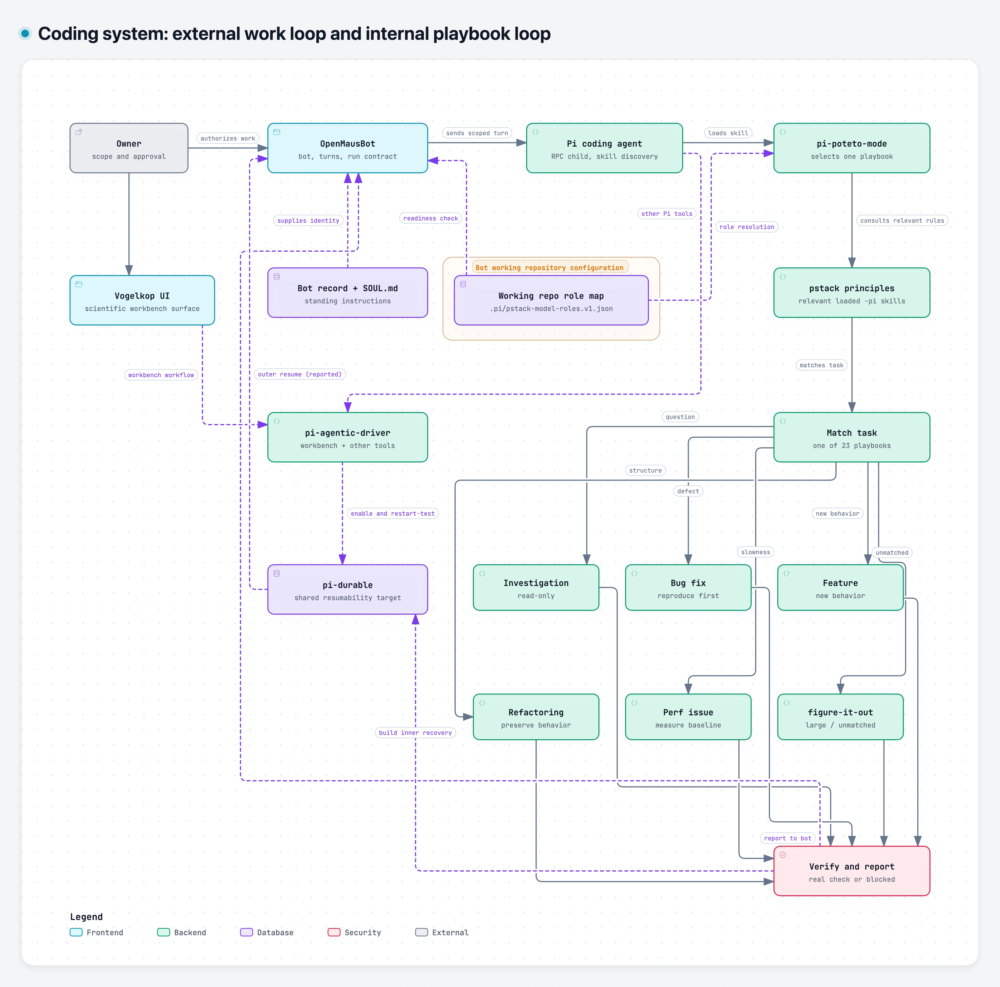
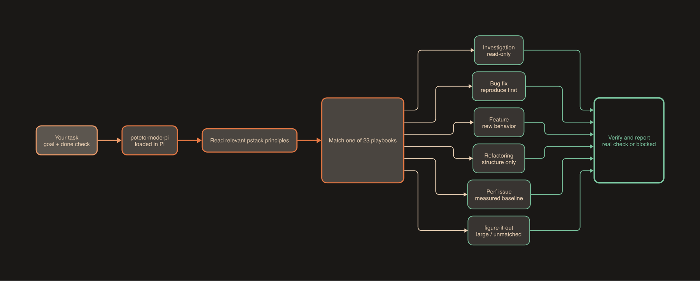

# @evoclock/pi-poteto-mode

<p align="center">
  <a href="LICENSE"></a>
  <a href="https://www.npmjs.com/package/@evoclock/pi-poteto-mode"></a>
  <a href="https://pi.dev/docs/latest/packages"></a>
  
</p>

The skills in this package are **[pstack](https://github.com/cursor/plugins/tree/main/pstack)
by Lauren Tan** (v0.15.25, MIT). Copyright stays with Lauren Tan. I adapted all
54 skills for the [Pi coding agent](https://pi.dev) to keep a port that is
maintainable and close to the upstream text, and to cover the gaps I found in
other Pi ports. This package holds only the adaptation; it adds no extensions or
workflows of my own.

For what pstack is and how its workflows fit together, read Lauren Tan's
[upstream pstack README](https://github.com/cursor/plugins/blob/main/pstack/README.md).
This README covers the Pi skills package and shows how it fits into the wider
coding system in which I use it. The surrounding integrations are separate projects and are still
under active development.

## System overview



[Download the interactive HTML](assets/pi-coding-system.html) to explore it
locally. The project-local role map belongs to the bot's working repository,
not to a bot identity or a running service. OpenMausBot uses it for readiness
checks; skills consult it for model roles. The shared resumability connections
are agreed design work, not verified crash recovery.

## Inside pi-poteto-mode



The six branches are common examples from upstream's
[poteto-mode guide](https://github.com/cursor/plugins/blob/main/pstack/docs/guide/02-poteto-mode.md);
the full method has 23 playbooks. The principles are adapted from pstack;
they are not built into Pi.

## Install

```sh
pi install npm:@evoclock/pi-poteto-mode
```

Add `-l` to install it for the current project only. Remove it with
`pi remove npm:@evoclock/pi-poteto-mode`.

## Set up roles

The skills never name a model. They ask for two roles, `development` and
`independent-review`, which you map once per project:

1. Run `/skill:setup-pstack-pi`, or copy
   `config/pstack-model-roles.v1.example.json` to `.pi/pstack-model-roles.v1.json`
   in your repository.
2. Set each role to an exact `provider/modelId` from your own Pi setup. The two
   roles must differ.

Keep that file out of version control if it names your own models. Until it is
filled in, skills that need a role stop and tell you to run setup.

## How this works in Pi

- **Naming.** Each upstream skill `name` becomes `name-pi`, for example
  `poteto-mode` becomes `poteto-mode-pi`. 52 of the 54 skills set
  `disable-model-invocation`, so they run only when you call them, for example
  `/skill:poteto-mode-pi`.
- **Install.** `pi install npm:@evoclock/pi-poteto-mode`, or `pi install <path>`
  for a local checkout. The `pi` field in `package.json` lists the 54 skill
  folders. The package ships no extensions and no install scripts.
- **Model roles.** Skills never name a model. They look up `development` and
  `independent-review` in `.pi/pstack-model-roles.v1.json`. Copy
  `config/pstack-model-roles.v1.example.json` (placeholders only) or run
  `/skill:setup-pstack-pi`.
- **Sync script.** `node scripts/sync-upstream.mjs <path-to-upstream-pstack>`
  reads a local upstream copy and reports its version, upstream skills missing
  here, and skills here with no upstream match.

## What's missing compared with upstream

[docs/adaptation-guide.md](docs/adaptation-guide.md) lists every Cursor tool or feature the skills had to adapt, with the affected skills, the Pi handling and its status.

These upstream features do not map to Pi yet:

- **Subagents.** Upstream ships Cursor agents (`agents/poteto-agent.md`,
  `agents/comment-sicko.md`) and fans work out to Cursor `Task` subagents. Pi has
  no built-in subagents, so the skills here only use workers when a separate,
  approved Pi dispatch route exists, and otherwise work sequentially.
- **Model roles.** Upstream has many roles with effort budgets, model panels and
  `auto`/inherit fallbacks. This port has two exact roles and no fallback.
- **Always-on mode.** Upstream's Poteto mode is a Cursor custom mode. In Pi,
  `poteto-mode-pi` applies only when you load it.
- **Automations.** Upstream's `automations/` folder and Cursor `/loop` have no
  Pi equivalent here.

My plan: first add a subagent mapping through a Pi extension in a separate
package, so this one stays a skills-only port. Then extend the roles file when
I can test more roles in Pi. I will add each piece only after it works in a real
Pi session.

## Maintenance

I pin each release to one upstream version, currently 0.15.25. When upstream
publishes a new version, I run the sync script against it, port new or changed
skills by hand, and keep the `-pi` names. The tests then check that every
upstream skill in the list is present, that frontmatter is valid and that no
model names or personal paths ship. Every change gets an independent review
before I merge it.

## Comparison with other Pi ports

On 18 Oct 2026 I compared nine published Pi ports with upstream v0.15.25. None
covered all 54 skills; the most complete had 51. Two run `postinstall` scripts
that write outside their install folder, and several hardcode model ids. The
method and findings are in
[docs/pstack-pi-ports-comparison.md](docs/pstack-pi-ports-comparison.md).

| # | Package | Version / last publish | Skills (missing / added) | Identical `SKILL.md` | Pi mapping of subagents, hooks and model roles | Install scripts / notes | Stars / open issues / last push | Hardcoded model ids |
|---|---|---|---|---|---|---|---|---|
| 1 | pi-herdr-pstack ([npm](https://www.npmjs.com/package/pi-herdr-pstack), [pi.dev](https://pi.dev/packages/pi-herdr-pstack)) | 0.3.2 / 16 Oct 2026 | 51 (missing in-your-own-words, ketchup, sharpen) | 13/51 | Pi extension for mode, setup and config; subagents through the `pi-herdr-agents` peer dependency | None; ships THIRD_PARTY_NOTICES and a changelog | 2 / 0 / 16 Oct 2026 | Almost none |
| 2 | @casualjim/pi-pstack ([npm](https://www.npmjs.com/package/@casualjim/pi-pstack), [pi.dev](https://pi.dev/packages/@casualjim/pi-pstack)) | 0.1.14 / 17 Oct 2026 | 50 (missing in-your-own-words, make-bot-ui, setup-pstack, sharpen) | 19/50 | Model roles through a config-backed roles extension | None; tarball includes `node_modules` (about 37 MB, 1,182 files) | 12 / 1 / 17 Oct 2026 (repo `casualjim/pi-mimir`) | Some model family names |
| 3 | @mccune1224/pi-pstack ([npm](https://www.npmjs.com/package/@mccune1224/pi-pstack), [pi.dev](https://pi.dev/packages/@mccune1224/pi-pstack)) | 0.2.0 / 13 Sep 2026 | 46 + 4 added (control-cli, control-ui, create-skill, deslop); 8 missing | 7/46 | Context guard, compaction and doctor extensions; upstream sync script and sync check | None | 2 / 2 / 13 Sep 2026 | Yes |
| 4 | @whamp/pi-pstack ([npm](https://www.npmjs.com/package/@whamp/pi-pstack), [pi.dev](https://pi.dev/packages/@whamp/pi-pstack)) | 0.10.1 / 12 Oct 2026 | 46 + code-review, deslop; 8 missing | 10/46 | Configurable model roles; ask-user-question tool | `postinstall` symlinks skills into `~/.agents/skills` (keeps existing entries; opt out with `PI_PSTACK_SKIP_SKILL_LINKS=1`) | 1 / 4 / 15 Oct 2026 | No |
| 5 | @zenspc/pi-pstack ([npm](https://www.npmjs.com/package/@zenspc/pi-pstack), [pi.dev](https://pi.dev/packages/@zenspc/pi-pstack)) | 0.6.0 / 9 Sep 2026 | 46 + deslop; 8 missing | 6/46 | Config plus a skill-strip extension | None | 10 / 6 / 9 Sep 2026 | No |
| 6 | potetos-for-everyone ([npm](https://www.npmjs.com/package/potetos-for-everyone), [pi.dev](https://pi.dev/packages/potetos-for-everyone)) | 0.1.0 / 10 Sep 2026 | 49 (adds triage-issue-reports, reproduce-and-fix-issues); 7 missing | 0/47 shared | Multi-agent installer with hooks and adapters rather than a native Pi package; based on upstream v0.15.0 | `postinstall` writes skills into the current project on a local install | 15 / 1 / 10 Sep 2026 | No |
| 7 | poteto-pi ([npm](https://www.npmjs.com/package/poteto-pi), [pi.dev](https://pi.dev/packages/poteto-pi)) | 0.1.0 / 5 Sep 2026 | 44 + loop; 10 missing | 1/44 | Generates 37 subagent files; memory, todo and update-check extensions | None | 0 / 0 / 5 Sep 2026 | Yes, in every generated agent |
| 8 | @0xrsydn/pstack-pi ([npm](https://www.npmjs.com/package/@0xrsydn/pstack-pi), [pi.dev](https://pi.dev/packages/@0xrsydn/pstack-pi)) | 0.15.1 / 27 Aug 2026 | 44; 10 missing | 1/44 | Own subagent extension | None; npm repository field points to `cursor/plugins` | 6 / not checked / 14 Oct 2026 | Yes |
| 9 | pi-pstack ([npm](https://www.npmjs.com/package/pi-pstack), [pi.dev](https://pi.dev/packages/pi-pstack)) | 0.1.0 / 8 Aug 2026 | 44; 10 missing | 1/44 | Basic agents extension | None; no repository field on npm | 8 / not checked / 8 Aug 2026 | No |

## Skills

Each skill carries a `-pi` suffix. Another package that ships skills with the
same names will clash: Pi keeps the first one it finds and warns. To load this
package's copies, exclude the other package's duplicates in your Pi settings,
for example `{ "source": "npm:other-package", "skills": ["!skills/*-pi"] }`.

- `architect-pi`
- `arena-pi`
- `automate-me-pi`
- `benchmark-checklist-pi`
- `blast-radius-pi`
- `bro-pi`
- `correct-pi`
- `create-verification-skill-pi`
- `figure-it-out-pi`
- `how-pi`
- `in-your-own-words-pi`
- `interrogate-pi`
- `ketchup-pi`
- `maintain-verification-skill-pi`
- `make-bot-ui-pi`
- `no-comments-pi`
- `poteto-help-pi`
- `poteto-mode-pi`
- `principle-attack-the-premise-pi`
- `principle-boundary-discipline-pi`
- `principle-build-the-lever-pi`
- `principle-encode-lessons-in-structure-pi`
- `principle-exhaust-the-design-space-pi`
- `principle-experience-first-pi`
- `principle-explain-the-number-pi`
- `principle-fix-root-causes-pi`
- `principle-foundational-thinking-pi`
- `principle-guard-the-context-window-pi`
- `principle-laziness-protocol-pi`
- `principle-make-operations-idempotent-pi`
- `principle-migrate-callers-then-delete-legacy-apis-pi`
- `principle-minimize-reader-load-pi`
- `principle-model-the-domain-pi`
- `principle-never-block-on-the-human-pi`
- `principle-outcome-oriented-execution-pi`
- `principle-prove-it-works-pi`
- `principle-redesign-from-first-principles-pi`
- `principle-separate-before-serializing-shared-state-pi`
- `principle-sequence-verifiable-units-pi`
- `principle-subtract-before-you-add-pi`
- `principle-test-behavior-not-implementation-pi`
- `principle-type-system-discipline-pi`
- `recall-pi`
- `reflect-pi`
- `setup-pstack-pi`
- `sharpen-pi`
- `show-me-your-work-pi`
- `swarm-pi`
- `tdd-pi`
- `teach-pi`
- `technical-writing-pi`
- `typescript-best-practices-pi`
- `unslop-pi`
- `why-pi`

## Keeping up with upstream

`node scripts/sync-upstream.mjs <path-to-upstream-pstack>` compares the port with
a local copy of upstream and lists missing or extra skills and the upstream
version. It only reads. I port upstream changes by hand and review each one.

## Tests

`npm test` checks that every upstream skill is present, that frontmatter is
valid, that no model names or personal paths ship, and what `npm pack` would
publish.

## How I use it

My preferred setup is open source and on-device: Pi, with Herdr panes for
parallel work, and OpenMausBot for automated work in very much the same way you use Grok Bot. 
Much of pstack's power comes from running it inside a full bot like Grok Bot, with background workers, routines and memory around it. This port covers what Cursor can't for me: local models and a free
choice of providers, set through the two model roles along with custom seams to other tools I run in my scientific and software development work.

## Licence

MIT; see [LICENSE](LICENSE). The upstream skills are by Lauren Tan,
MIT; see [NOTICE](NOTICE).
